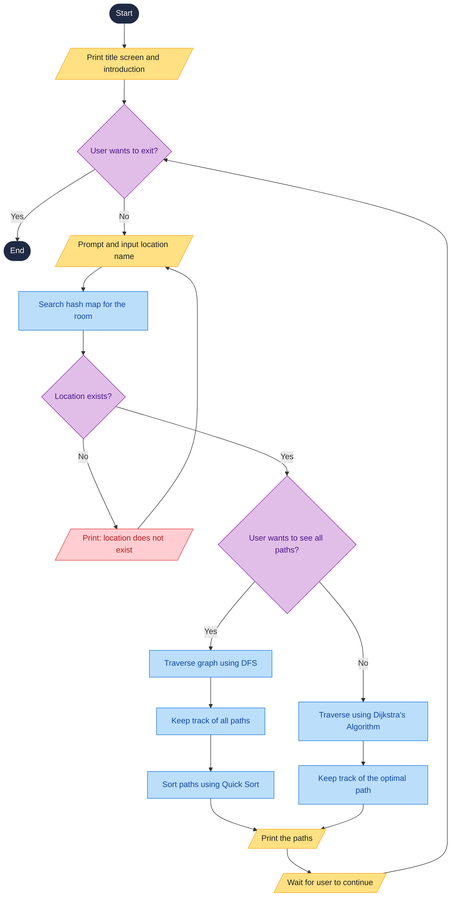

<div align="center">

<!-- Course badges -->


<br /><br />

# 🧭 MediCompass
### `> Find your way to any hospital location.`
**Hospital Directional Guidance System, built in C++.**
*Business process emulated: Hospital Guidance and Department Referral.*

<br />

<!-- Tech stack row -->


<!-- Algorithms row -->


<br /><br />

<!-- Quick facts -->


</div>

<br />

<!-- Add a screenshot or GIF of the program running here, e.g.: -->
<!-- <p align="center"></p> -->

## 📖 Overview
At a hospital front desk, every visitor asks the staff for directions. This causes long queues, different staff give different routes, and only one person can be helped at a time.

**MediCompass** emulates the *Hospital Guidance and Department Referral Process* with a console program. Starting from the **Main entrance**, the user types the name of a location (not case-sensitive). The program verifies that it exists using a hash map, then shows step-by-step walking directions based on the user's choice:
* 🧭 **All Possible Routes:** Traverses the graph using Depth-First Search (DFS) and sorts the routes by distance using Quick Sort, shortest first.
* ⚡ **Shortest Route:** Calculates and displays the most efficient route using Dijkstra's Algorithm.

---

## ✨ Features

| | Feature | How |
| :---: | :--- | :--- |
| 🖥️ | **Console Interface** | Title screen and a main menu (Find Location, Browse Locations, How to use the system, Exit) controlled with the arrow keys, Enter and Esc |
| 🔎 | **Location Lookup** | Hash map: fast search by location name, not case-sensitive. Shows the name and floor of the location found |
| 🗺️ | **Hospital Mapping** | Weighted graph of 30 locations across 3 floors; edges are corridor distances in meters |
| ⚡ | **Shortest Route** | Dijkstra's Algorithm with a priority queue: the single shortest path |
| 🧭 | **All Possible Routes** | DFS finds every route without looping, then Quick Sort orders them by distance |
| 📝 | **Step-by-Step Directions** | Each route lists every walking step in meters, the total distance, and the search time in milliseconds |
| ⛔ | **Restricted Areas** | Restricted locations (nurse stations, ICU, operating room, recovery room) cannot be a destination, and routes never pass through them |
| 🛡️ | **Input Handling** | Unknown locations are reported and the user can try again or type `back` to return |

---

## 🧠 Data Structures and Algorithms

| Topic | Used for | Time complexity |
| :--- | :--- | :--- |
| 🟣 Hash map (`unordered_map`) | Location lookup by name | O(1) average, O(n) worst |
| 🟢 Weighted graph (adjacency list) | Hospital map | Add edge O(1) |
| 🔵 Dijkstra + priority queue | Shortest route | O((V + E) log E) |
| 🟠 Depth-first search (DFS) | Listing all possible routes | Grows with the number of routes (exponential in the worst case) |
| 🟪 Quick Sort | Sorting routes by distance | O(n log n) average, O(n²) worst |

*V = number of locations, E = number of corridors, n = number of routes.*

---

## 🔄 How It Works



1. The program starts and shows the title screen and introduction.
2. If the user chooses to exit, the program ends. Otherwise, it asks for a location name.
3. The program searches the hash map. If the location does not exist, it says so and asks again.
4. If it exists, the user chooses the shortest route or all possible routes.
5. **All possible routes:** DFS finds every route, and Quick Sort orders them by distance.
6. **Shortest route:** Dijkstra's Algorithm finds the single best path.
7. The program prints the step-by-step directions and waits for the user to continue.

---

## 🖥️ Sample Run

A search for **Pharmacy**, choosing the **shortest route**:

```text
Type a location name (example: Pharmacy), or 'back' to return: Pharmacy

LOCATION FOUND
--------------------------------------------------------------------------
  Name  : Pharmacy
  Floor : Ground floor
--------------------------------------------------------------------------

Which route do you want?
  > Shortest route
    All possible routes
  [1/2]  Up/Down = Move, Enter = select, Esc = back

HOSPITAL NAVIGATION RESULT - SHORTEST ROUTE
==============================================================================
Starting Point : Main entrance
Destination    : Pharmacy (Ground floor)

Recommended Route:
  1. Start at the Main entrance.
  2. Walk 10 meters from Main entrance to Lobby.
  3. Walk 12 meters from Lobby to Registration.
  4. Walk 8 meters from Registration to Cashier.
  5. Walk 10 meters from Cashier to Pharmacy.
  6. You have arrived at Pharmacy.

Total Distance : 40 meters
==============================================================================

  Search complete (0.040 ms).

Search for another location? (y/n):
```

<details>
<summary>Choosing <b>All possible routes</b> instead (first two of 10 routes shown)</summary>

```text
HOSPITAL NAVIGATION RESULT - ALL AVAILABLE ROUTES
==============================================================================
Starting Point : Main entrance
Destination    : Pharmacy (Ground floor)
Routes found   : 10 (shortest first)
------------------------------------------------------------------------------
ROUTE 1  (Shortest) - 40 meters
  1. Start at the Main entrance.
  2. Walk 10 meters from Main entrance to Lobby.
  3. Walk 12 meters from Lobby to Registration.
  4. Walk 8 meters from Registration to Cashier.
  5. Walk 10 meters from Cashier to Pharmacy.
  6. You have arrived at Pharmacy.
------------------------------------------------------------------------------
ROUTE 2 - 80 meters
  1. Start at the Main entrance.
  2. Walk 15 meters from Main entrance to Elevator G.
  3. Walk 15 meters from Elevator G to Emergency.
  4. Walk 20 meters from Emergency to Lobby.
  5. Walk 12 meters from Lobby to Registration.
  6. Walk 8 meters from Registration to Cashier.
  7. Walk 10 meters from Cashier to Pharmacy.
  8. You have arrived at Pharmacy.
```

</details>

---

## 📂 Project Files

| File | Description |
| :--- | :--- |
| `main.cpp` | Main program execution. |
| `graph.h` | Graph data structure (adjacency list). |
| `hospital_header.h` | Hospital layout: locations, floors, restricted flags, corridors and the name lookup. |
| `interface.h` | User interface and console outputs. |
| `routes.h` | Pathfinding algorithms (DFS, Dijkstra) and Quick Sort. |

---

## ⚠️ Scope and Limitations
* Predefined hospital layout of 30 locations (no adding locations or corridors without editing the code)
* Console interface only (no GUI or 3D map)
* Data is kept in memory only; closing the program deletes all data
* Single user; no networking, databases, real patient data, billing or appointments

---

## 👥 Team Composition
**CPE21S2 / Group 6**

* **Condino, Niel Vincent**: Project Leader
* **Esguerra, Paula**
* **Estorco, Clint Hoven**
* **Libo-on, Gian Carlo**
* **Lopez, Andrei Dion**: Input and Display Interface
* **Mendoza, Nathaniel**: Output and Display Interface

---

<div align="center">

🎓 **CPE 010 Data Structures and Algorithms**
Technological Institute of the Philippines, Quezon City
Instructor: Engr. Jimlord M. Quejado

</div>
